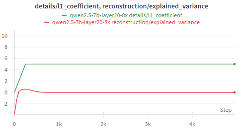
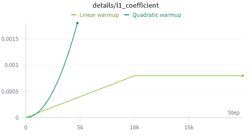
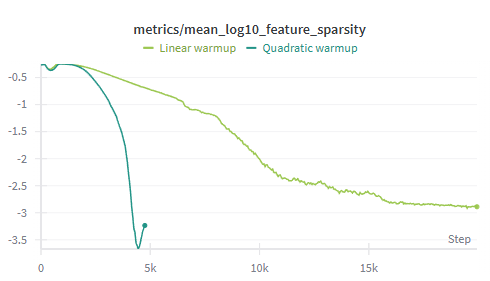
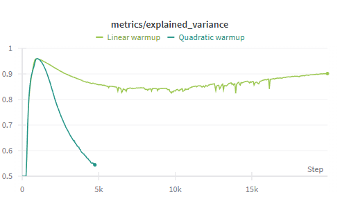
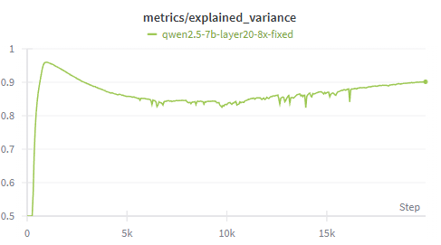
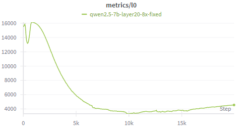
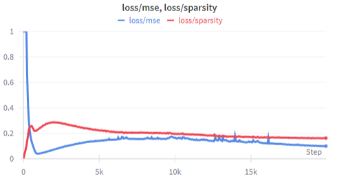
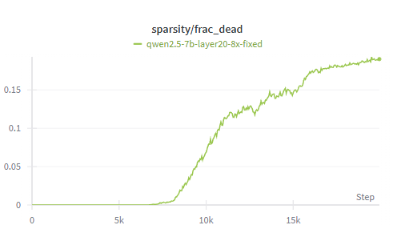
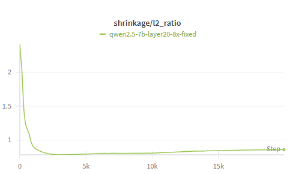

# Sparse Autoencoder Training on Qwen2.5-7B

**Richard Shan** · Machine Learning Final Project · December 2025

**The full writeup is available in [ML_Final.pdf](ML_Final.pdf).** This README summarizes the project; the PDF contains the complete report.
Sparse Autoencoders (SAEs) have emerged as a promising tool for understanding the internal latent spaces of large language models. This project documents the training of an SAE on Qwen2.5-7B, a 7 billion parameter language model, using approximately 10 million activation vectors extracted from the SlimPajama dataset. Starting with a prototype on the Tiny Stories 21M parameter model, I scaled my approach to Qwen2.5-7B, encountering and addressing challenges including feature death from aggressive sparsity penalties and decoder weight drift. The final model achieves 90% explained variance with approximately 4,000 active features per input.

## Repository Structure

| File | Description |
|---|---|
| `tutorial_training_a_sparse_autoencoder.ipynb` | Stage 1 prototype: SAE on TinyStories-1L-21M using sae-lens |
| `extract_qwen_slimpajama.py` | Extracts layer-20 residual stream activations from Qwen2.5-7B over SlimPajama |
| `normalize_activations (1).py` | Normalizes cached activations to zero mean, unit variance |
| `train_sae_qwen2.5_7b_fixed.py` | Custom SAE training pipeline for Qwen2.5-7B |
| `figures/` | Training curves and diagrams |
| `ML_Final.pdf` | Full project report |

## Usage

```bash
# 1. Extract activations
python extract_qwen_slimpajama.py  # TODO: add args

# 2. Normalize
python "normalize_activations (1).py"  # TODO: add args

# 3. Train
python train_sae_qwen2.5_7b_fixed.py  # TODO: add args
```

---

## Introduction

As large language models (LLMs) become increasingly capable and widely deployed, understanding their internal mechanisms has become a critical challenge. Their capacity to generate detailed solutions and solve problems has already transformed how students learn, how researchers work, and how organizations make decisions. Models such as GPT, Claude, and DeepSeek are now used in tutoring platforms, data analysis systems, and technical support workflows, yet their decision-making processes remain largely opaque. Mechanistic interpretability aims to reverse-engineer LLMs to understand how they represent and process information.

Sparse Autoencoders (SAEs) have emerged as a promising approach to this challenge. An SAE learns to decompose a model's internal activations into a sparse set of interpretable features. This project investigates SAE training on Qwen2.5-7B, a production-scale 7 billion parameter language model. While most SAE research has been conducted with billions of training tokens, I explore what can be achieved with more limited resources: approximately 10 million tokens, or 20–100× less than typical published work.

## Background

### Sparse Autoencoder Motivation

The internal states of a large language model are high-dimensional and densely entangled, making them extremely difficult to interpret directly. In Qwen2.5-7B, the residual stream at block 20 has 3,584 dimensions, yet the model must represent far more distinct concepts than this dimensionality allows. As a result, many features are superposed: multiple unrelated concepts overlap in the same neurons, and conversely, individual concepts are spread across many neurons.

Sparse autoencoders are designed to address this problem. By training an overcomplete dictionary of features and enforcing sparsity in the hidden layer, SAEs map dense activations into a higher-dimensional space where only a small fraction of features fire at once. This sparsity forces specialization, encouraging different features to encode distinct, consistent patterns rather than overlapping mixtures. In other words, the autoencoder "untangles" superposed signals, yielding features that can be studied as discrete representational units.

### Sparse Autoencoder Architecture

An SAE consists of two components: an encoder that maps input activations to a higher-dimensional sparse representation, and a decoder that reconstructs the original activations from this sparse code.

Given an input activation $\mathbf{x} \in \mathbb{R}^{d_{in}}$ from a language model's hidden layer, the encoder produces feature activations:

$$\mathbf{f} = \text{ReLU}(\mathbf{W}_{enc} \mathbf{x} + \mathbf{b}_{enc})$$

where $\mathbf{W}_{enc} \in \mathbb{R}^{d_{sae} \times d_{in}}$ and $\mathbf{b}_{enc} \in \mathbb{R}^{d_{sae}}$. The ReLU activation ensures non-negative feature activations, with zero indicating an inactive feature. The decoder reconstructs the input:

$$\hat{\mathbf{x}} = \mathbf{W}_{dec} \mathbf{f} + \mathbf{b}_{dec}$$

where $\mathbf{W}_{dec} \in \mathbb{R}^{d_{in} \times d_{sae}}$. Each column of $\mathbf{W}_{dec}$ can be interpreted as a "feature direction" in activation space.

Typically, $d_{sae} > d_{in}$ (often 4–16× larger), creating an overcomplete representation. The sparsity constraint ensures that despite having more features than input dimensions, only a small subset activates for any given input.

### Training Objective

SAE training optimizes a combined loss function balancing two objectives:

$$\mathcal{L} = \underbrace{\|\mathbf{x} - \hat{\mathbf{x}}\|_2^2}_{\text{Reconstruction (MSE)}} + \lambda \underbrace{\|\mathbf{f}\|_1}_{\text{Sparsity (L1)}}$$

The **reconstruction loss** (MSE) encourages the SAE to accurately reproduce the input activations. Without this term, the model could trivially achieve sparsity by outputting zeros.

The **sparsity loss** (L1 penalty) encourages feature activations to be sparse. The L1 norm penalizes the sum of absolute activation values, pushing the model toward solutions where most features are exactly zero.

The coefficient $\lambda$ controls the tradeoff between these objectives. Higher $\lambda$ produces sparser representations but may sacrifice reconstruction quality. Finding the right balance is a central challenge in SAE training.

<p align="center">
  <br>
  <em><b>Architecture of the SAE.</b> The SAE encodes LLM activations into a sparse latent space and decodes them back to a reconstruction, optimizing reconstruction error with an added sparsity term.</em>
</p>

### Key Metrics

- **L0 (Feature Count):** The average number of non-zero features per input. Lower values indicate sparser representations. For interpretability, L0 values of 100–500 are typically desirable.
- **Explained Variance:** The fraction of input variance captured by the reconstruction, computed as $1 - \text{MSE}/\text{Var}(\mathbf{x})$. Values above 0.90 indicate good reconstruction quality.
- **Dead Features:** Features that never activate across training. These represent wasted model capacity and can accumulate if the L1 penalty is too aggressive.
- **L2 Ratio:** The ratio $\|\hat{\mathbf{x}}\|_2 / \|\mathbf{x}\|_2$. A ratio of 1.0 indicates the SAE preserves activation magnitudes, which is important for downstream interpretability analysis.

## Approach

The approach proceeded in two stages: first validating the training pipeline on a small model, then scaling to Qwen2.5-7B.

### Stage 1: Prototype on Tiny Stories

Before committing to a 7 billion parameter model, I validated the approach on Tiny Stories, a 21 million parameter single-layer transformer. This model is well understood in the interpretability community and serves as a standard testbed. I trained the SAE with the following configuration from an sae-lens tutorial:

- **Model:** `tiny-stories-1L-21M`
- **Hook point:** `blocks.0.hook_mlp_out`
- **Input dimension:** 1,024
- **SAE dimension:** 16,384 (16× expansion)
- **L1 coefficient:** 5
- **Training steps:** 30,000
- **Batch size:** 4,096

Without any tuning or optimization, the TinyStories SAE achieves the following performance, confirming that the training setup was correct.

| Metric | Value | Assessment |
|---|---|---|
| Explained Variance | 68% | Acceptable |
| L0 (features per input) | 134 | Good |
| Dead Features | 0.2% | Excellent |
| L2 Ratio | 0.78 | Moderate |

### Stage 2: Scaling to Qwen2.5-7B

Scaling the pilot SAE to Qwen2.5-7B required substantial modifications to the approach.

#### Activation Collection

Rather than computing activations on the fly during training (which would require running the 7B model at each step), I pre-extracted and cached activations over the corpus. I processed text from SlimPajama, a high-quality web text corpus.

- **Activation vectors:** 10 million
- **Hidden dimension:** 3,584
- **PT data size:** 145 GB
- **Preprocessing:** Normalized to zero mean, unit variance

I extracted activations from layer 20, a mid-to-late layer in the residual stream out of Qwen2.5-7B's 28 total layers. The residual stream integrates contributions from both the attention and MLP sublayers, preserving the cumulative state of computation. Early layers primarily encode token-level embeddings, while final layers reflect surface-form outputs. By contrast, mid-level residual streams contain semantically rich intermediate representations thought to support reasoning. The normalization step is important for training stability: raw activations from large models can have extreme outliers that destabilize optimization.

#### Training Architecture

To support the scale of the cached activation dataset and the specific control required for experimentation, I developed a custom training pipeline from scratch rather than using the sae-lens trainer used for TinyStories.

- **Input dimension:** 3,584
- **SAE dimension:** 28,672 (8× expansion)
- **Total parameters:** 205 million

#### Iterative Hyperparameter Development

Scaling from Tiny Stories to Qwen2.5-7B required extensive experimentation to identify working hyperparameters. The L1 coefficient that worked for Tiny Stories (5.0) immediately killed all features when applied to Qwen2.5-7B, producing 100% dead features and near-zero explained variance.

**Initial Failure Analysis.** The first Qwen2.5-7B training runs exhibited catastrophic failure. Within the first few hundred steps, explained variance collapsed to approximately zero, and the fraction of dead features approached 100%. Debugging revealed that the L1 sparsity penalty was overwhelming the reconstruction objective, as shown below.

<p align="center">
  <br>
  <em>L1 sparsity overwhelming reconstruction explainability.</em>
</p>

By monitoring the MSE-to-sparsity loss ratio and pre-activation statistics, I found that the optimizer discovered that the easiest path to minimize total loss was to push encoder biases negative. This caused all pre-activations to become negative, which ReLU then zeroed out, effectively killing every feature.

**Systematic L1 Coefficient Search.** I developed diagnostic scripts to empirically test different L1 coefficients on batches of the normalized activation data. For each candidate coefficient, I computed the resulting MSE loss, sparsity loss, and their ratio, along with the L0 and dead feature fraction.

The target was a sparsity-to-MSE ratio between 0.5× and 2.0×: high enough to encourage sparsity but not so high as to overwhelm reconstruction. My search revealed that the appropriate L1 coefficient for normalized Qwen2.5-7B activations was approximately 6,250× smaller than what worked for Tiny Stories.

**Warmup Schedule Design.** Applying the full penalty from step zero caused feature death. Features need time to learn representations before sparsity is applied; otherwise, the optimizer kills them before they become valuable. I experimented with two warmups:

- **Quadratic warmup:** $\lambda(t) = \lambda_{max} \cdot (t/T_{warmup})^2$. This starts slowly but accelerates mid-warmup, causing a sudden spike in sparsity pressure.
- **Linear warmup:** $\lambda(t) = \lambda_{max} \cdot (t/T_{warmup})$. This provides a constant-rate increase throughout warmup.

<p align="center">
  <br>
  <em>L1 coefficient by warmup.</em>
</p>

Quadratic warmup initially appeared gentler, but its acceleration mid-training caused features to die en masse. Linear warmup gradually adapts the model to increasing sparsity pressure.

<p align="center">
  <br>
  <em>Feature sparsity by warmup. The linear warmup produces a stable model that becomes more sparse over steps, but the quadratic warmup immediately kills features.</em>
</p>

Quadratic warmup enforces sparsity before useful representations are learned. Features do not have time to learn meaningful representations, are treated as non-representative, and die off. The quadratic warmup SAE therefore technically has higher sparsity than the linear warmup SAE, but is useless in practice, as shown below.

<p align="center">
  <br>
  <em>Explained variance by warmup. Quadratic scaling kills learned representations, causing explained variance to collapse.</em>
</p>

**Architecture Modifications.** Beyond hyperparameters, I made several architectural decisions to improve training stability:

1. **Encoder bias initialization** to +0.05 rather than zero. This small positive bias prevents immediate feature death by ensuring pre-activations start in a range where some pass through ReLU.
2. **Soft decoder normalization.** Standard practice normalizes decoder columns to unit norm after each optimizer step. However, I found this hard constraint caused training instability in my setting. I replaced it with a soft penalty term in the loss function: $\mathcal{L}_{dec} = \alpha \sum_i (\|\mathbf{w}_i\|_2 - 1)^2$, where $\mathbf{w}_i$ is the $i$-th decoder column.
3. **Gradient norm clipping** (max norm 1.0) to prevent large parameter updates during the volatile early training phase.
4. **Tied initialization.** I initialized the encoder as a scaled transpose of the decoder ($\mathbf{W}_{enc} \approx 0.5 \cdot \mathbf{W}_{dec}^T$), providing a better starting point than random initialization.

#### Tradeoffs in SAE Design

Some design decisions did not have a clear correct answer. In these cases, I used my best judgment for this specific SAE application.

**Hard vs. Soft Decoder Normalization.** Normalizing decoder columns to unit norm after each step (hard normalization) prevents features from operating at different scales, simplifying interpretation. However, I found it caused training instability, with loss oscillating rather than converging smoothly. Soft normalization via a penalty term maintained stability but allowed decoder norms to drift from 1.0 to a range of 2–13 over training. I prioritized training stability, accepting that feature scales would require post-hoc normalization for fair comparison.

**Sparsity vs. Reconstruction.** Higher L1 coefficients produce sparser representations but risk feature death and degraded reconstruction. The final L0 of ~4,000 features per input (14% density) is sparser than a vanilla autoencoder but higher than the ideal 1–2% for interpretability. Pushing further toward ideal sparsity would require working resampling to prevent the additional feature death that a higher L1 would cause.

**Training Duration vs. Resource Constraints.** Longer training generally improves results, but practical constraints limited my run to 20,000 steps. Core metrics (explained variance, L0) had largely stabilized by step 15,000, suggesting diminishing returns from additional training, though this may reflect the specific hyperparameters rather than a fundamental limit.

## Results

After addressing the challenges described above, my final training run produced a functional SAE with the following characteristics after 20,000 training steps:

| Metric | Value | Assessment |
|---|---|---|
| Explained Variance | 90% | Excellent |
| L0 (features per input) | ~4,000 | Moderate |
| Dead Features | 17% | Moderate |
| L2 Ratio | 0.86 | Good |

### Explained Variance

<p align="center">
  <br>
  <em>Explained variance over training. After initial instability during L1 warmup, the metric stabilizes at approximately 0.90.</em>
</p>

Explained variance is the primary metric for evaluating SAE quality. It measures what fraction of the original activation's variance is preserved after encoding into sparse features and decoding back:

$$\text{Explained Variance} = 1 - \frac{\text{MSE}(\mathbf{x}, \hat{\mathbf{x}})}{\text{Var}(\mathbf{x})}$$

A value of 1.0 would indicate perfect reconstruction; a value of 0.0 would indicate the SAE performs no better than simply predicting the mean activation. Negative values, which appear briefly in early training, indicate the reconstruction is actively worse than predicting the mean.

This metric quantifies the fundamental tradeoff in SAE training. The sparsity constraint forces the model to represent each input using only a small subset of features, which necessarily discards some information. An SAE with high sparsity but low explained variance has learned to ignore its inputs; an SAE with high explained variance but low sparsity is just a regular autoencoder. The goal is achieving both simultaneously.

The chaotic early period reflects the transition from pure reconstruction (when the L1 coefficient is near zero) to sparse reconstruction (as L1 warmup progresses). During this transition, the model restructures from using ~16,000 features to ~4,000, temporarily sacrificing reconstruction quality as it searches for a new equilibrium. The stable plateau at 0.90 means 90% of the variance in Qwen2.5-7B's layer-20 activations is captured by the sparse feature representation.

### Feature Sparsity (L0)

<p align="center">
  <br>
  <em>L0 over training. The spike to 16,000 reflects the initial reconstruction phase; the subsequent drop to ~4,000 shows sparsity enforcement.</em>
</p>

Initially, with a near-zero L1 coefficient, the model activates as many features as needed for reconstruction (~16,000, or 56% of all features). As L1 warmup progresses, the model is penalized for using too many features and compresses to ~4,000 active features (14%). While 4,000 is higher than the ideal 100–500, it represents a 4× compression from the initial state.

### Loss Components

<p align="center">
  <br>
  <em>MSE loss (blue) and sparsity loss (red) over training.</em>
</p>

The MSE loss drops rapidly from ~2.5 to ~0.09 as the model learns to reconstruct activations, then remains stable. The sparsity loss rises during L1 warmup as the coefficient increases, peaks around steps 2,000–3,000, then gradually decreases as the model learns to use fewer features more efficiently. The convergence of both losses indicates the model found a stable equilibrium balancing both objectives.

### Dead Features

<p align="center">
  <br>
  <em>Fraction of dead features over training.</em>
</p>

Dead features accumulate steadily. By the end of training, 17% of features (~5,000) are dead: they contribute nothing to reconstruction and cannot be interpreted. This accumulation accelerated after step 10,000, when the L1 coefficient reached its full value. Features that were marginally useful got pushed below the activation threshold and never recovered.

While 17% dead features is not ideal, it is within the range reported by published SAE work and leaves 83% of features (~24,000) functional.

### Reconstruction Scaling

<p align="center">
  <br>
  <em>L2 ratio (reconstruction magnitude / input magnitude) over training.</em>
</p>

Starting at ~2.3 (reconstructions initially more than twice as large as inputs), the ratio drops rapidly during early training and stabilizes at approximately 0.86, meaning reconstructions are 86% the magnitude of inputs. This shrinkage is a known phenomenon in sparse coding: the L1 penalty incentivizes smaller feature activations, which propagates to smaller reconstructions. While 1.0 would be ideal, 0.86 indicates the SAE is not dramatically distorting activation scales, and this 14% shrinkage is acceptable for downstream interpretability work.

## Discussion

### Limitations

- **Sparsity.** With ~4,000 features per input (14% density), the SAE is sparser than a vanilla autoencoder but not as sparse as ideal (1–2% density, or 300–600 features). A higher L1 coefficient could improve sparsity but risks additional feature death without working resampling.
- **Data scale.** Training on only 10 million tokens means rare activation patterns may not be well represented in the learned features. The industry norm is 100 million to 1 billion tokens; more data would likely improve feature quality and reduce dead features.
- **Single layer.** I only analyzed layer 20 of Qwen2.5-7B's 28 layers. Different layers likely encode different types of information.

### Future Work

- Train on 100 million to 1 billion tokens to expose the SAE to more diverse activations.
- Extend to multiple layers to compare how representations evolve across the model's depth.
- **Feature interpretation:** find the inputs that maximally activate each feature and identify semantic patterns. This is where the scientific value of SAEs is ultimately realized.
- Downstream applications including circuit analysis, steering model behavior, and detecting problematic representations.

## Conclusion

This project trained a sparse autoencoder on Qwen2.5-7B, a 7 billion parameter language model. Starting from a prototype on Tiny Stories, I developed a complete pipeline for activation extraction and SAE training. The final SAE achieves 90% explained variance while compressing representations from over 16,000 active features to approximately 4,000 per input. I've done extensive work on the downstream aspects of mechanistic interpretability (causal interventions, reasoning feature optimization, etc.), but had never explored how SAEs themselves are trained. This project was valuable to my growth as an AI alignment researcher.

## Appendix: Training Configuration

Final hyperparameters for Qwen2.5-7B SAE training:

```yaml
SAEConfig:
  d_in: 3584
  d_sae: 28672  # 8x expansion
  batch_size: 4096
  total_steps: 20000
  lr: 1e-4
  l1_coefficient: 0.0008
  l1_warmup_steps: 10000
  lr_warmup_steps: 1000
  lr_decay_start: 15000
  decoder_norm_penalty: 0.001
  resample_frequency: 5000
  dead_feature_threshold: 5000
```
